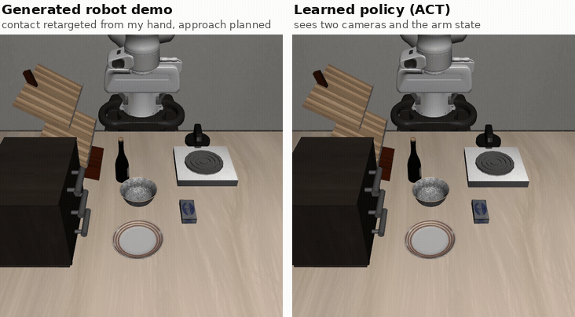
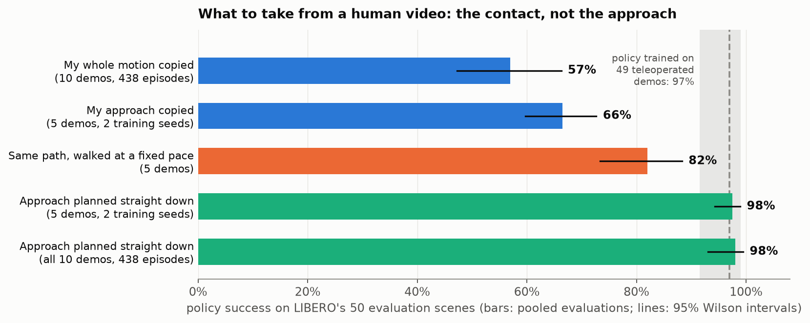
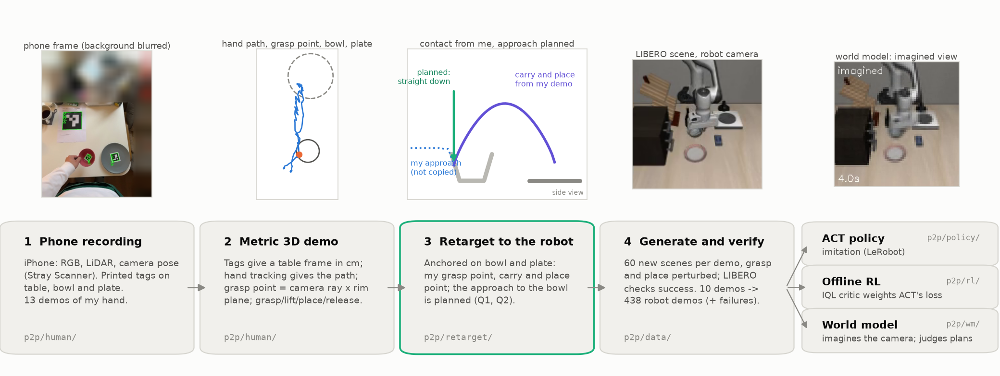
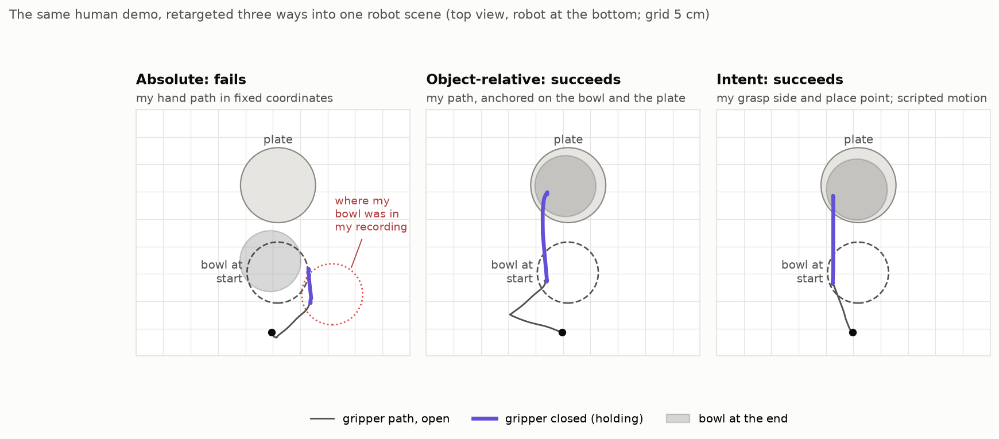
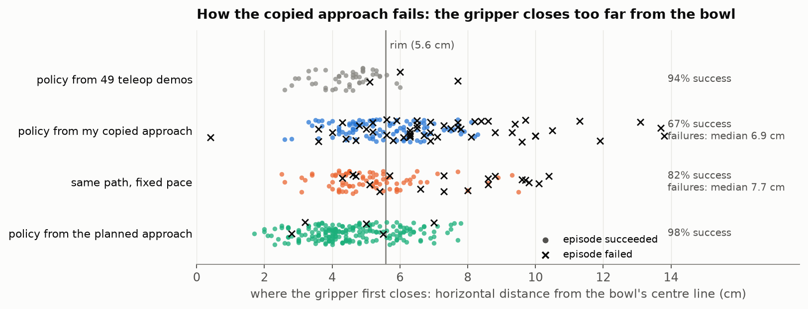
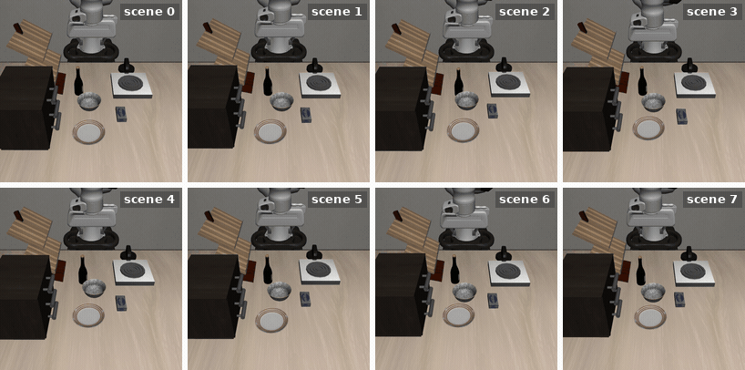
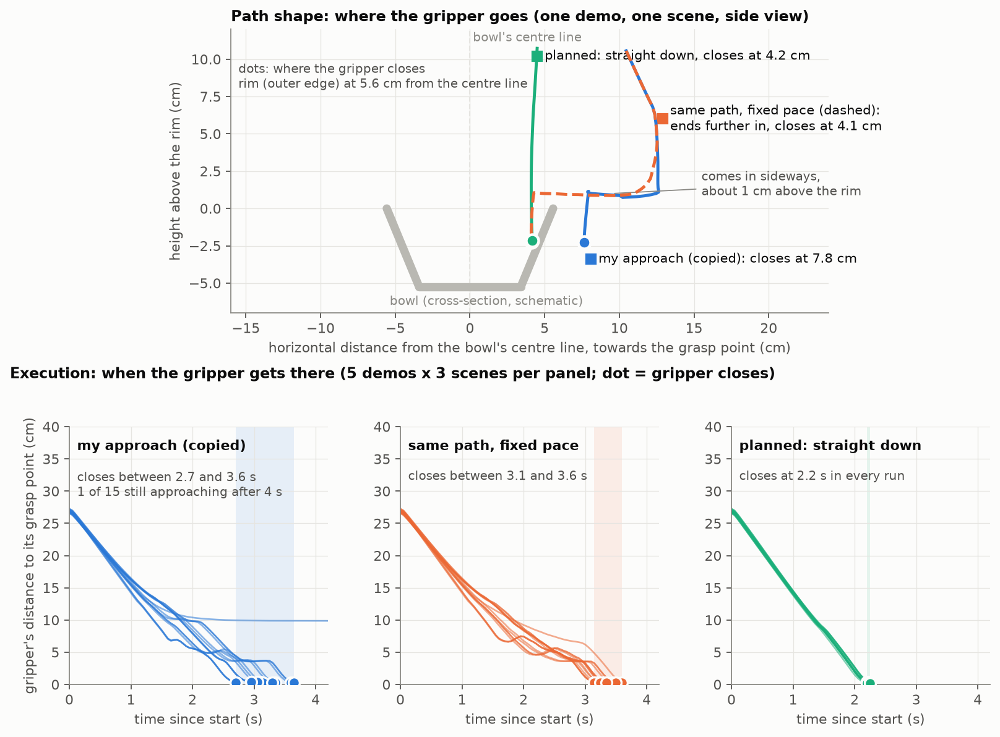

# phone2panda

**Learning robot policies from phone videos of a human hand.**

I recorded my own hand putting a bowl on a plate with an iPhone. This repository turns each recording into a
metric 3D demonstration, retargets it to a Franka Panda in the LIBERO simulator (LIBERO-Goal, *"put the bowl
on the plate"*), and multiplies it into hundreds of robot demonstrations, each checked by the simulator. On
that data it trains an imitation policy (ACT), tests whether offline RL can learn from the failed attempts,
and trains a world model that imagines the robot's camera to judge plans before they run.

The question running through the project: **what exactly should be transferred from a human video?** The
short answer: the contact (where the hand grasps the bowl, how it carries it, where it sets it down), not the
path the hand took to get there. A policy trained on demos that keep my contact and plan the approach succeeds
98% of the time, as often as one trained on teleoperated demos (97%); copying my whole motion gives 57%.


*One of my recordings (background blurred). Printed tags on the table, bowl and plate give a metric frame;
the hand and the bowl are tracked from grasp to release.*



*Left: a robot demo generated from one of my recordings: my grasp point, carry and place point, retargeted to
this scene, with the approach to the bowl planned; the simulator checked that it succeeds. Right: the ACT
policy trained on 438 such demos from my 10 training recordings, in an evaluation scene it never trained in.
It sees two 128 px cameras and the arm state; the video is rendered at higher resolution. It succeeds in 98%
[93-99] of evaluation episodes ([the first 8 scenes, none left out](#policy-8-scenes)).*

## Results at a glance



| Question | Answer | Results (95% Wilson intervals) |
|---|---|---|
| **What exactly should be transferred from a human video?** ([Q2](#q2-imitation-from-sim-verified-phone-data-act)) | The contact: where to grasp, how to carry, where to place. Copying how my hand approached the bowl gives demos the robot can replay but a policy cannot learn; planning that approach instead gives teleop-level policies. | Same 5 demos and scenes: copied approach 66% [60-73], planned approach **98% [94-99]** (2 training seeds). All 10 demos: 57% [47-66] → **98% [93-99]**. Policy from 49 teleoperated demos: 97% [92-99] |
| **How should a human demo be retargeted to the robot's scene?** ([Q1](#q1-retargeting-what-transfers-from-a-human-demo)) | Relative to the objects. Replaying the hand path in fixed coordinates never works. | Scripted replays, 13 demos x 20 scenes: absolute 0% [0-2], object-relative 81% [76-85], intent 100% [99-100] |
| **How can you tell whether demos are learnable?** ([Q2](#a-quick-check-are-the-demos-learnable)) | Train one policy, then run it averaging its overlapping action predictions. Learnable demos barely notice; demos that teach conflicting moves collapse. | Averaged: 92-100% for every policy trained on learnable demos, 12-48% for those trained on my copied approach (12 runs) |
| **Does learning from the failed rollouts help?** ([offline RL](#learning-from-failures-offline-rl-gated)) | Not measurably. A first +12-point result was evaluation noise. | IQL-weighted 64% [54-73], same data unweighted 60% [50-69], successes only 57% [47-66] |
| **Can a world model judge a plan before execution?** ([Q3](#q3-world-model-can-it-judge-a-plan-before-execution)) | It ranks plans well from their executed actions, but cannot yet pick one before acting. | Success AUROC 0.93 imagining whole held-out episodes from their first frame; choosing among 13 plans: 78% [65-87] vs 71% random and 98% for the best fixed demo |

*Policy success is measured on LIBERO's 50 fixed evaluation scenes, which were never used to make training
data; each rate pools two evaluations of 50 episodes per training seed.*


*The world model on a demo it never saw: left the real camera, right its imagination from the first frame and
the action sequence alone (64 px, 10 Hz). Failure example: [assets/wm_hero_failure.mp4](assets/wm_hero_failure.mp4).*

## Pipeline



<details>
<summary>The same pipeline as text, with datasets and notebooks</summary>

```
iPhone (RGB 1920x1440 + LiDAR + ARKit pose)             p2p/human/
  ArUco tags on table / bowl / plate -> metric table frame; ARKit + tag-anchored camera track
  MediaPipe hand -> pinch point, grasp point on the rim (camera ray ∩ rim plane), events: grasp/lift/place/release
        |
        v  13 demos that pass every check (data/splits.json): 10 for training, 3 held out
retargeting to the robot                                   p2p/retarget/
  absolute | object-relative | intent (Q1); final recipe: object-relative contact + planned approach
        |
        v
sim-verified data generation (MimicGen-style)              p2p/data/      notebook 02
  60 fresh scenes per demo (objects shifted +-3 cm, grasp/place perturbed); LIBERO decides success
  600 rollouts -> 438 successes (ours_all); all 600 kept for offline RL (ours_mix)
        |
        +--> ACT (LeRobot)                                 p2p/policy/    notebook 03; investigation 06-15
        +--> IQL critic -> advantage weights -> AW-ACT     p2p/rl/        notebooks 05, 03
        +--> world model (image + bowl, 10 Hz)             p2p/wm/        notebook 04
                 +--> world model as a plan critic                        notebook 07
```

</details>

## Data: my recordings

- 25 recordings of my hand: iPhone with LiDAR (RGB, depth and camera pose, Stray Scanner app), printed tags on
  the table, bowl and plate. **13 pass every check** and form the main set: 10 for training, 3 held out (chosen
  before any training). 6 more, made with my natural grasp, are used only in Q1; 6 were excluded because the
  hand was hidden at the grasp.
- The scene was laid out differently in every recording (figure), which matters for retargeting (Q1).
- Protocol, setup, checks and the measurement lessons: [docs/data_collection.md](docs/data_collection.md).


*Left: my 13 demos as recorded. The bowl started in many places and the plate in a few, which is why a
replay in fixed coordinates (absolute) cannot work. Right: the same paths relative to the bowl, which is
how object-relative retargeting sees them. Straight segments are gaps where the hand tracker lost the hand.*

## Q1. Retargeting: what transfers from a human demo?

A recording gives my hand's 3D path (the point between thumb and index finger), the moments I closed and
opened my fingers, the point on the rim where I grasped, and where the bowl and plate were. Retargeting turns
this into a plan for the robot in its own scene: a sequence of gripper poses, each with the gripper open or
closed. Three ways to do it, from "copy everything" to "copy only the intent":

- **Absolute: replay my hand's path in fixed coordinates.** Every point of the path is converted into the
  robot's frame by one transform shared by all demos: my seat becomes the robot's base, and my average bowl
  position becomes the simulator's average bowl position. Where the bowl and plate are in a particular robot
  scene is ignored. This is what treating the video as a robot trajectory means.
- **Object-relative: replay my path relative to the objects.** The approach and the grasp point are expressed
  relative to the bowl (heights relative to its rim), so they move with the bowl. The carry is stretched to
  start at the robot's bowl and end at the robot's plate while keeping its shape (how high and along which
  curve I carried it), and the bowl is set down at the same offset from the plate centre as in my demo.
- **Intent: keep only what I meant to do.** Two facts: which side of the bowl I grasped (an angle around the
  rim) and where on the plate I put it. The motion itself is a standard hand-written pick-and-place: above
  the rim, straight down, close, lift 12 cm, carry, lower, open.

In object-relative and intent, the wrist is turned so the two fingers close across the rim wall at the grasp
point. My own finger orientation is not used: it is noisy, and a slanted pinch lets the bowl twist.

Each of the 13 main demos replayed in 20 of LIBERO's evaluation scenes (`results/table1.md`):

| Strategy | Keeps from my demo | Success | Demos >= 50% |
|---|---|---|---|
| absolute | the whole hand path, in fixed coordinates | 0% [0-2] | 0/13 |
| object-relative | grasp point, approach, lift and carry shape, place point, all relative to bowl/plate | 81% [76-85] | 11/13 |
| intent | only the grasp side and the place point | 100% [99-100] | 13/13 |



*One of my demos retargeted three ways into the same evaluation scene (scripted teacher, physics only;
`tools/strategies_figure.py`). Absolute replays my path where my bowl was in the recording, about 11 cm from
the robot's bowl, so the gripper closes on nothing; object-relative follows my path anchored on the bowl and
the plate; intent keeps only the grasp side and the place point.*

Angles below go around the bowl in the robot's frame: 0° is the far side, 90° the robot's left, 180° the
side facing the robot, 270° the robot's right.

- **Absolute fails completely, as expected: it is the negative control.** My recordings were laid out
  differently each time. The bowl started a median 11 cm (2-37 cm) from its average position, and the plate
  lay in front of, beside or behind it, 26-39 cm away. In the robot's scenes the bowl is always near the same
  spot, 16 cm from the plate. A fixed replay therefore sends the gripper to where the bowl was in my
  recording, typically about 11 cm from where it is in the robot's scene, and the fingers close on empty air.
  The bowl ends a median 14 cm from the plate, having started 16 cm away: it is at most nudged, never carried.
- **Object-relative works for 11 of 13 demos; the other two inherit assumptions of my scene**
  (`results/table1_notes.md`):
  - `a4558` (1/20): I carried the bowl along an S-curve that swings about 9 cm to the robot's right and
    20 cm up. In my room that was free space; in the LIBERO scene a cabinet stands there. The held bowl hits
    the cabinet, the arm stalls for about 100 steps, and the bowl is released 11 cm above the table, 6-7 cm
    from the plate centre.
  - `c521` (4/20): I grasped at 149°, the most extreme side of all main demos (towards the side facing the
    robot). Following my approach path to that side, the arm gets stuck (about 230 of 300 steps) and the
    episode times out.

  Intent succeeds 20/20 on both, because it plans its own path. The more of the human motion we keep, the more
  of the human scene's assumptions we inherit.
- **My natural grasp side does not work for this robot.** In 6 extra recordings I grasped the bowl without
  instructions, on the side facing me or on my right. Retargeted to the robot (my seat = the robot's base), that
  is the side facing the robot (177-200°) or the robot's right (272°). From there the retargeted grasps
  mostly fail: 9-20/20 at about 180°, 4-14/20 at about 200°, 0/20 at 272° (object-relative and intent). So
  the main recordings follow a protocol: grasp the bowl's left rim (86-149° in the robot's frame). This
  constraint on the human is a real limitation: a natural human grasp is not necessarily one the robot can
  execute.
- **Design choice: data generation uses object-relative, not intent**, although intent scores higher. Intent
  keeps only two numbers from the video, so its data would be my hand-written pick-and-place with two
  parameters set by the human, and a policy trained on it would learn the script rather than the
  demonstrations. Object-relative keeps the demonstrated motion, and the simulator discards the rollouts where
  that motion does not suit the robot's scene.
- **Revised after Q2:** keep my grasp point, lift, carry and place point, but plan the approach to the bowl
  (`object_relative_vertical`). The robot can execute my approach, but a policy cannot learn it (see Q2).

## Q2. Imitation from sim-verified phone data (ACT)

### How the robot demonstrations are made

There is no separate planner. The "teacher" that produces robot demonstrations is the retargeted plan,
executed by a simple feedback controller:

1. **Plan.** Object-relative retargeting (Q1) of one human demo onto a new scene gives about 30 gripper
   waypoints (position, wrist angle, open or closed).
2. **Execute.** Every 50 ms, a waypoint follower commands a move towards the current waypoint, proportional
   to the remaining distance, and moves on to the next waypoint once it is close enough (or after a timeout).
   The camera images and the commanded actions are recorded.
3. **Verify.** LIBERO's own success check decides whether the episode is kept.

To get many robot demos from 10 human ones (the MimicGen recipe), this runs in 60 fresh scenes per demo. The
bowl and plate are shifted by up to ±3 cm on top of LIBERO's own placement noise. The human's grasp point is
moved along the rim (standard deviation 1 cm, about 11° around the bowl) and the place point is moved
(1.5 cm), so the data covers more grasps than the 10 I recorded. Result: 600 rollouts, 438 successes (73%;
my per-demo prediction from physics-only replays was 75%). Failures are mostly near-misses: half end on the
plate but more than 3 cm from its centre, which LIBERO's `On` check rejects.

Datasets: `ours_all` = the 438 successes; `ours_50` = 50 successes (5 per demo), the same count as the
official demos; `ours_mix` = all 600 rollouts, successes and failures (for offline RL); `official` = the 49
teleoperated demos of this task in `lerobot/libero`.

### Results

ACT (LeRobot, 20k steps, batch 32, same settings for every run), evaluated on the 50 fixed scenes:

| Training data | Episodes | Success | Bowl never lifted | Lifted, off the plate | On the plate, > 3 cm off |
|---|---|---|---|---|---|
| official teleop (`lerobot/libero`) | 49 | **97%** [92-99] (2 evals, n=100) | 0 | 0 | 0 |
| ours_50 (count-matched) | 50 | **46%** [33-60] | 13 | 7 | 7 |
| ours_all | 438 | **57%** [47-66] (2 evals, n=100) | 16 | 4 | 1 |
| ours_mix + IQL advantage weights | 600 | **64%** [54-73] (2 evals, n=100) | 10 | 2 | 7 |
| ours_mix, unweighted (control) | 600 | **60%** [50-69] (2 evals, n=100) | 15 | 1 | 1 |
| ours_consistent: 5 demos with grasp sides within 10° (H2 test) | ~250 | **59%** [49-68] (2 evals, n=100) | 8 | 4 | 8 |
| ours_consistent_clean: same 5 demos, 450 fresh episodes | 450 | **67%** [57-75] (2 evals, n=100) | 7 | 5 | 6 |
| ours_consistent_dart: same scenes, DART noise during generation | 450 | **64%** [54-73] (2 evals, n=100) | 8 | 4 | 2 |
| **ours_consistent_vertical: same scenes, approach planned straight down (H9 test)** | 450 | **99%** [95-100] (2 evals, n=100) | 0 | 1 | 0 |
| ours_consistent_intent: same scenes, fully scripted motion (pipeline ceiling) | 450 | **100%** [96-100] (2 evals, n=100) | 0 | 0 | 0 |
| ours_consistent_clean, training seed 1 | 450 | **66%** [56-75] (2 evals, n=100) | 10 | 5 | 5 |
| ours_consistent_vertical, training seed 1 | 450 | **96%** [90-98] (2 evals, n=100) | 0 | 2 | 2 |
| **ours_all_vertical: all 10 demos, `ours_all`'s scenes, approach planned** | 438 | **98%** [93-99] (2 evals, n=100) | 0 | 0 | 0 |
| ours_consistent_timed: my approach's path, walked at a fixed pace (notebook 15) | 450 | **82%** [73-88] (2 evals, n=100) | 3 | 4 | 3 |

Failure columns are from one evaluation of 50 episodes each. For reference, the teacher itself (unperturbed
plans of the 10 training demos, executed by the follower) succeeds in 85% [79-89] of 20 of these scenes (Q1's
replays, `results/table1.csv`).

- **The gap to teleop is in grasping, not placing.** Most failures never lift the bowl. When our policy does
  grasp, it places about as accurately as the teleop policy (median 1.9 vs 1.1 cm from the plate centre).
  The investigation below traces it to the approach to the bowl, and planning that approach closes the gap.
- **9x more generated data: 46% -> 57%**, not significant. It seems to sharpen placement (7 vs 1
  off-centre failures) but not grasping.
- **Re-grasps, but in the wrong place:** after a missed grasp the policy closes again (3-7 times per failed
  episode, notebook 11), each time too far out from the bowl's centre.
- **Averaging the policy's own predictions breaks ours, not the teleop one** (12% vs 100%): the first sign
  that our demos teach conflicting moves ([quick check](#a-quick-check-are-the-demos-learnable)).

### Why is the policy trained on my demos worse than the one trained on teleoperation?

Both policies have the same architecture, settings, simulator, cameras and evaluation scenes; only the
demonstrations differ. Most of our failures are missed grasps (16 of 21 never lift the bowl), and successful
grasps are followed by accurate placement. So the question is why grasps fail. I proposed explanations one at
a time and tested each with a prediction, and the threshold that would confirm or reject it, written into the
notebook before it ran:

| | Hypothesis | Test | Verdict |
|---|---|---|---|
| H1 | **Teacher ceiling:** a student rarely beats its teacher | the scripted teacher's own success in the evaluation scenes | Minor: the teacher with my approach succeeds 95%, which explains at most ~4 of the 32 missing points |
| H2 | **Inconsistent grasps:** my demos grasp the rim at different places (86-149°) | train on the 5 demos with similar grasp sides (notebook 08) | A symptom, not the cause: 59%, no better; once the approach is planned, all 10 inconsistent demos reach 98% (notebook 13) |
| H3 | **The ±1 cm grasp perturbation** used in data generation | its spread compared with the spread across my demos | Likely minor (11° vs 20°); not tested |
| H4 | **Too-clean demos:** the data never shows corrections | DART noise during generation, on the same scenes (notebook 09) | Not supported: 64% vs 67% |
| H5 | **Open-loop action chunks** during a precise grasp | execute 10 instead of 25 actions per prediction; re-plan every step (notebook 06) | Rejected: 50% and 12%, no better |
| H6 | **Training and evaluation images differ** | (by construction) | Ruled out: same renderer, camera and resizing for both |
| H7 | **Under-training:** ~12 passes over our data vs ~140 over the teleop demos | train 3x longer (notebook 10) | Rejected: 69% -> 61% -> 58% as training continues |
| H8 | **The teacher needs precision the policy cannot see** | plans built from deliberately wrong object positions (physics only) | Rejected: 90% success even with 3 cm bowl error |
| H9 | **Copying my approach to the bowl** | the same data with the approach planned straight down (notebooks 12-15) | **Confirmed:** 66% -> 98% (two seeds; 98% with all 10 demos) |

The full table with all evidence, the per-notebook predictions and the order of the experiments:
[docs/investigation.md](docs/investigation.md). What located the cause was not another success rate but
recording where the gripper closes (notebook 11): in failed episodes our policy closed too far from the bowl's
centre, then tried again 3-7 times in the wrong place.



*Where each policy first closes the gripper, as horizontal distance from the bowl's centre line (one dot per
evaluation episode; x = failed episode; values above 14 cm drawn at the edge). The teleop policy closes inside
the rim in 90% of episodes and the policy trained with the planned approach in 75%; neither ever closes more
than 8 cm out. The policy trained on my copied approach closes inside the rim in only 44% of episodes, and 17 of
its 50 failures close more than 8 cm out. Closing slightly outside the rim can still work, because the fingers
open about 8 cm.*

**Conclusion: the gap comes from copying my approach to the bowl.** In a controlled comparison (same demos,
scenes, perturbations, dataset size and training), planning the last few centimetres before the grasp instead
of copying them raises the policy from 66% to 98% (two training seeds, two evaluations each), the level of the
teleop policy (97%). Everything else the policy learns from my demos, the grasp point on the rim, the lift, the
carry and the place point, transfers. With all 10 of my training demos, on exactly the scenes of `ours_all`,
the planned approach gives 98% where copying my approach gave 57%.

| | Teacher in these scenes | Policy, seed 0 | Policy, seed 1 | Policy closes (from the bowl's axis) |
|---|---|---|---|---|
| my approach (object-relative), 5 demos | 95% | 67% [57-75] | 66% [56-75] | 5.5 cm in successes, 7.1 cm in failures |
| approach planned straight down, 5 demos | 99% | **99%** [95-100] | **96%** [90-98] | 4.2-4.4 cm |
| fully scripted (intent), 5 demos | 100% | 100% [96-100] | - | 5.0-5.4 cm |
| my approach, all 10 demos (`ours_all`) | 83% | 57% [47-66] | - | 5.4 cm in successes, 7.7 cm in failures |
| approach planned straight down, all 10 demos | 91% | **98%** [93-99] | - | 3.9 cm |
| my approach's path at a fixed pace, 5 demos | 98% | 82% [73-88] | - | 5.0 cm in successes, 6-9 cm in failures |

<a id="policy-8-scenes"></a>


*The policy trained on all 10 demos with the planned approach (98%), in the first 8 of the 50 evaluation
scenes, none left out (notebook 16, `tools/hero_gif.py`). The scenes differ by LIBERO's placement noise.*

<a id="approach-figure"></a>


*What "my approach", "fixed pace" and "planned" mean (scripted teacher, physics only; `tools/approach_figure_*.py`).
Top: **path shape**, the places the gripper passes through, for one demo in one scene, seen from the side. My
copied approach comes in sideways about 1 cm above the rim, then goes down; the planned one comes straight
down; the fixed-pace version follows my path to its end and so closes further in. Bottom: **execution**, when
the gripper reaches its grasp point, for 5 demos x 3 scenes. My copied approach arrives at a different moment
for each demo (and once got stuck); the fixed pace narrows that; the planned approach arrives at the same
moment every time.*

- **A demonstration the robot can execute is not necessarily one a policy can learn.** The teacher with my
  approach succeeds 95% of the time; the policy trained on it, 66%. The planned approach comes straight down
  and closes at the same moment in every demo and scene (spread 1.2 steps), like the teleop policy (2.5 steps);
  mine closes at a moment that differs between demos (median 54-72 steps).
- **Both the path's shape and how it is executed matter, roughly half each** (notebook 15). Walking my path at
  a fixed pace, which also moves the grasp 0.7 cm further inside the rim, gives 82% [73-88]: halfway between my
  approach (66%) and the planned one (98%), the outcome the fixed prediction called "both contribute". The
  policy still closes at a variable moment and still collapses when its predictions are averaged (34%): a
  sideways path just above the rim leaves it unsure when and where to close. Timing and grasp margin changed
  together and are not separated.
- **Inconsistent grasp sides stop mattering once the approach is planned** (notebook 13, prediction: >= 90%
  means no extra cost). My 10 demos grasp the rim anywhere between 86° and 149° and still give 98%.
- **The difference replicates across training seeds** (notebook 14, prediction: planned >= 90%, copied
  <= 75%): seed 1 gives 96% vs 66%. Pooled over both seeds, 98% [94-99] vs 66% [60-73], n = 200 each.
- **Is planning the approach a cheat?** No, but it limits the claim. The planner uses the same information as
  the copied version (my grasp point and the bowl's position) plus one rule: start 8 cm above the grasp point
  and go straight down. There is no search and no learning. The catch is elsewhere: the fully scripted run,
  which keeps only my grasp side and place point, also reaches 100%, so on this task what my demo adds beyond
  a script is a few numbers. The task is too easy to show the human's real value, which should appear where the
  contact itself is hard to write down by hand: unfamiliar objects, unusual grasps, specific placements.
- **How far the split generalises.** "Contact from the human, free motion from a planner" fits tasks where the
  space around the object is open, as on a tabletop. Where the approach is itself the hard part (reaching into
  a drawer, inserting, working around clutter), a straight line is not enough: the planner needs a model of the
  scene, and the human's path may be the informative part. Published work makes the same split. VRB (Bahl et
  al., 2023) learns from human videos only where a hand touches an object and how it moves right after contact.
  SkillMimicGen (Garrett et al., 2024) generates robot data by adapting only the object-interaction segments of
  demonstrations and connecting them with free-space motion (motion-planned in its Isaac Lab implementation).
  MimicGen, which this project follows, still copies each segment's approach relative to the object, which
  works for its teleoperated source demos; for human demos, notebook 12 shows the approach is the part not
  to copy.

### A quick check: are the demos learnable?

A demo that a robot can replay is not necessarily a demo a policy can learn from. A cheap check once you have
trained one policy: evaluate it again with temporal ensembling, i.e. query it at every step and execute the
average of the overlapping action predictions. If the demos were consistent, the predictions agree and the
average works as well as before. If the demos taught conflicting moves, the predictions disagree and their
average is a move nobody demonstrated.

One command runs it (`p2p/policy/learnability.py`):

```bash
python -m p2p.policy.learnability runs/<run>/final   # GPU: two evaluations of 50 episodes, then a verdict
python -m p2p.policy.learnability results/act/*/     # no simulator: this table's verdicts from the saved evaluations
```

It reports how much of the normal success rate survives averaging. Policies trained on consistent demos kept
93-103% in our runs, policies trained on conflicting demos 21-76%, so the tool calls >= 90% consistent and
< 80% conflicting. One evaluation of 50 episodes is not always enough on its own: in two of the seven
conflicting runs (DART, longer training) the drop was only 14-16 points, inside its 95% interval.

| Training data | Normal execution | Predictions averaged | Results |
|---|---|---|---|
| official teleop demos | 97% | 100% | [`official_s0/eval_te.json`](results/act/official_s0/eval_te.json) |
| fully scripted motion | 100% | 100% | [`ours_consistent_intent_s0/`](results/act/ours_consistent_intent_s0/) |
| planned approach (5 demos, seeds 0 and 1; all 10 demos) | 96-99% | 92-94% | [`ours_consistent_vertical_s0/`](results/act/ours_consistent_vertical_s0/), [`_s1/`](results/act/ours_consistent_vertical_s1/), [`ours_all_vertical_s0/`](results/act/ours_all_vertical_s0/) |
| my copied approach (6 runs: data size, DART, seeds, longer training) | 57-67% | **12-48%** | [`ours_all_s0/`](results/act/ours_all_s0/), [`ours_consistent_clean_s0/`](results/act/ours_consistent_clean_s0/), [`ours_consistent_dart_s0/`](results/act/ours_consistent_dart_s0/), ... |
| my approach's path at a fixed pace | 82% | 34% | [`ours_consistent_timed_s0/`](results/act/ours_consistent_timed_s0/) |

Looking more often without averaging does not help either: executing 10 instead of 25 of the 50 predicted
actions gives 96% for the teleop policy and 50% for ours (`results/act/*/eval_n10.json`).

Temporal ensembling is not our invention: it is ACT's own inference mode in the original paper (Zhao et al.,
2023), which weights the overlapping predictions exponentially to make motion smoother. It is no longer the
usual way to run chunked policies: LeRobot's ACT leaves it off by default, and most recent policies execute
part of a chunk and then predict again (as all our main results do). We use it as a probe, not as the way to
deploy: averaging is known to fail when a policy's predictions are multimodal, and that failure is exactly
what reveals demonstrations that teach conflicting moves. This is a consistent pattern across our 12 runs with
this check, not a tested general rule, and it says that something is inconsistent, not what; recording where
the policy closes the gripper (notebook 11) is what located the cause.

### Learning from failures (offline RL, gated)

ACT on successes only throws away the 162 failed rollouts. An IQL critic (expectile 0.7, gamma 0.99, reward 1
at success) trained on the simulator's 18-D state scores every frame: its advantage says whether the action
taken there did better or worse than usual from that state. ACT is then retrained on all 600 episodes with
loss weights `exp(beta * A)` on standardised advantages (beta = 1, mean 1, capped at 20). The critic sees the
simulator state; the policy sees only its cameras and its own arm state.

- Gate, fixed before the run: the critic must tell success from failure halfway through an episode.
  AUROC 0.95 (0.66 from the first frame) -> passed (`results/rl/iql_diagnostics.json`).
- Weights: success frames 1.15 on average, failure frames 0.82; 36% effective sample size.
- Result, three ways to use the same 600 rollouts (each checkpoint evaluated twice on the 50 scenes):

  | Training data | First evaluation | Second evaluation | Pooled (n=100) |
  |---|---|---|---|
  | successes only (filtered imitation, ours_all) | 56% | 58% | 57% [47-66] |
  | all rollouts, unweighted (control) | 54% | 66% | 60% [50-69] |
  | all rollouts, IQL advantage-weighted | 66% | 62% | 64% [54-73] |

  The first evaluation suggested a 12-point gain from the weights. Re-evaluating the same checkpoints (GPU
  evaluation is not bit-reproducible) moved the unweighted run by 12 points, so a single 50-episode evaluation
  cannot resolve differences of this size. Pooled, the three are within noise of each other: **no measurable
  effect of learning from failures** at this scale. That is not proof of no effect: weighted minus unweighted
  is +4 points with a 95% interval of roughly -9 to +17, and this interval is optimistic, because both
  evaluations reuse the same 50 scenes and training-seed variation (one seed each) is not included.

## Q3. World model: can it judge a plan before execution?

A world model predicts what the camera will see after a given sequence of robot actions, without running the
simulator. Here it is used to judge a plan before executing it.

```
 real camera frame (64x64 px)
        |  encoder (4 conv layers)
        v
   z_t: 256 numbers summarising the scene             robot actions for the next 0.1 s
        |                                             (2 control steps x 7 numbers = 14)
        v                                                         |
   +-----------------------------------------------+              |
   | GRU with a 512-number memory                  | <------------+
   | z_t+1 = z_t + predicted change                |
   +-----------------------------------------------+
        |   repeat from z_t+1 with the next actions: no new camera frames ("imagination")
        |
        +--> decoder (4 deconv layers) --> imagined camera frame at t+0.1 s
        +--> bowl head (small MLP)     --> bowl position (x, y, z) at t+0.1 s
```

- **10 Hz.** The robot is controlled at 20 Hz (one 7-number action every 50 ms: gripper move, wrist rotation,
  open/close). The world model takes steps of 0.1 s, so each of its steps consumes two consecutive actions (14
  numbers) and predicts the frame 0.1 s later. A 7 s episode is then 70 model steps instead of 140, which
  halves the number of predictions chained on top of each other.
- **Deterministic:** one predicted future per action sequence, no uncertainty.
- **Training signal:** real frames must survive encoder -> decoder; imagined frames must match the real future
  frames; imagined summaries are pulled towards the encoder's summary of the real future frame; and the bowl
  head must read the true bowl position (from the simulator) from both real and imagined summaries.
- **Open-loop training with a curriculum.** Each training example is a window of an episode: the model sees
  only its first real frame plus the actions, imagines the whole window step by step from its own
  predictions (as it will at test time), and is penalised at every step. Windows start at 8 steps (0.8 s) and
  grow steadily to 32 steps (3.2 s) by the middle of training (10k of 20k updates), then stay at 3.2 s. Short
  windows first teach one step of motion; long windows later teach the model not to drift, which matters
  because it is later asked to imagine whole episodes of up to 15 s.
- **Data:** 680 training episodes (+80 for validation) from the 10 training demos, successes and failures,
  all three strategies. Test: **180 episodes of the 3 held-out demos**, each replayed with all three strategies
  in the same 20 scenes.

### How well does it predict?

Starting from a real frame, the world model imagines up to 4 s ahead using the actions that were really
executed, and its prediction is compared with what happened (1226 start points: one per second of every test
episode, wherever 4 s remain). Two simple baselines and a ceiling put the numbers in context:

| Seconds imagined ahead | 0.1 | 1 | 2 | 4 |
|---|---|---|---|---|
| **Image similarity to the real frame** (PSNR, dB; higher is better) | | | | |
| world model: its imagined frame | 30.3 | 27.9 | 26.9 | 25.3 |
| baseline "nothing moves": the start frame itself | 39.1 | 28.7 | 25.9 | 22.9 |
| ceiling: the real frame passed through encoder and decoder | 30.7 | 30.1 | 29.9 | 29.0 |
| **Bowl position error while the bowl is moving** (cm; lower is better) | | | | |
| world model: bowl read from its imagined state | - | 5.4 | 6.3 | 6.0 |
| baseline "the bowl stays where it was" | - | 5.6 | 7.7 | 11.3 |

PSNR compares pixels: 30 dB is an average pixel error of about 3% of full brightness, 25 dB about 6%, 23 dB
about 7%. Bowl rows only count start points where the bowl has moved more than 2 cm by that time (none at
0.1 s), otherwise "stays where it was" would be trivially right. The same numbers, at every horizon:


- **Short horizons favour the "nothing moves" baseline.** In 0.1 s the scene hardly changes, so the start
  frame is almost a perfect prediction (39 dB). The model's frame is worse (30.3 dB) but only 0.4 dB below
  the ceiling: at short horizons its error is the blur of its autoencoder (every frame squeezed through 256
  numbers), not wrong motion.
- **From about 1.3 s on, the model beats "nothing moves"**, and the margin grows (25.3 vs 22.9 dB at 4 s): it
  predicts where the arm and the bowl go.
- **The gap to the ceiling grows from 0.4 to 3.7 dB over 4 s.** Each imagined step builds on the previous one,
  so small errors compound.
- **The bowl:** assuming it stays put is off by 11 cm after 4 s of carrying; the model by 6 cm, and its error
  does not grow with the distance travelled: it knows the bowl travels with the gripper. Its reading of a
  carried bowl is coarse, though (4-6 cm; at 64 px the bowl is small and partly hidden by the gripper),
  which is more than LIBERO's 3 cm success tolerance.

### Success from imagination

To judge an episode, take the real frame H seconds before its end, then imagine the remaining H seconds from
the recorded actions alone: every step in between is predicted from the model's own previous prediction, with
no further real frames. What is imagined is the model's internal summary, from which both a frame and the
bowl position can be read; for scoring, only the bowl position at the last step is used. The score is the
horizontal distance from that imagined bowl to the plate centre (the plate does not move). AUROC is the
probability that a random successful episode gets a smaller distance than a random failed one (0.5 = chance,
1 = perfect; the true final bowl position gives 0.99). H = 0 reads the bowl from the real last frame;
"whole episode" imagines everything from the first frame, which is the setting of judging a plan before
executing it.

| Imagined before the end | 0 | 0.5 s | 1 s | 2 s | 4 s | 8 s | whole episode |
|---|---|---|---|---|---|---|---|
| AUROC, all strategies (n=180) | 0.98 | 0.95 | 0.96 | 0.86 | 0.96 | 0.96 | 0.97 |
| AUROC, object-relative only (n=60) | 0.96 | 0.95 | 0.89 | 0.80 | 0.91 | 0.89 | **0.93** |


The object-relative row is the harder test: within one strategy, successes and failures look alike, whereas
across strategies "absolute never moves the bowl" is easy to see. The dip at 2 s is not understood. A
plausible cause: 2 s before the end the bowl is usually held in the gripper above the plate, partly hidden,
which is exactly where the bowl reading is least accurate; imagining from earlier frames starts from a clear
view of the bowl.

**Judging plans before execution** (from the first frame and the plan's actions). "Predicted" counts the
episodes whose imagined final bowl lies within 3.2 cm of the plate centre (a threshold chosen on the
validation episodes):

| Strategy | True success | Predicted by the world model |
|---|---|---|
| intent | 97% | 80% |
| object-relative | 57% | 32% |
| absolute | 0% | 0% |

It ranks the strategies in the true order, on demos it never saw, but is pessimistic: its coarse reading of
the bowl (see above) turns narrow successes into predicted failures.

**Why no "success" head.** An obvious design would add a classifier that reads "will this succeed?" from the
imagined state. In this data such a head can cheat: LIBERO ends an episode the moment it succeeds, while
failures run to the 300-step limit, so successes are short and failures long, and the end of a success
always shows the bowl just being set down. A head could learn to recognise the episode's length or its last
moments instead of the outcome; it would score well here and fail on plans of any other length. The bowl
position is supervised at every frame of every episode and is a physical quantity, so reading success from
it (with LIBERO's own criterion, distance to the plate centre) cannot take that shortcut.

### Choosing a plan with the world model (notebook 07)

Can the world model make a decision, not just rank strategies? In each of the 50 evaluation scenes the robot
has 13 candidate plans: the object-relative retargeting of each main demo, with a random grasp and place
perturbation as in data generation. The world model must pick one before anything is executed. It needs the
action sequence of each plan, but the waypoint follower computes actions by feedback on the gripper pose, so
the sequence is produced against a nominal model of the arm (how the gripper moves for a given command,
fitted on free motion; `tools/fit_arm_model.py`). The model knows the arm, not the bowl or the cabinet. The
world model imagines each sequence from the scene's real first frame, and the candidate whose imagined bowl
ends closest to the plate is executed. All 650 candidates were also run in the simulator, only to score the
choice (`results/plan_select/`):

| Rule for choosing one of the 13 candidates | Success (50 scenes) |
|---|---|
| oracle: some candidate succeeds | 100% |
| always the demo with the best generation yield (`65ee`), fixed in advance | 98% |
| world model on the nominal action sequences | **78%** [65-87] |
| a random candidate (average over the 13) | 71% |

- **The world model barely beats a random choice (+7 points, not significant) and loses clearly to a trivial
  rule.** Within a scene it separates working from failing candidates only weakly (AUROC 0.69, against 0.93
  on the held-out test episodes above).
- **Why: its input, not its imagination.** On the test episodes it was given the actions that were really
  executed. Here it gets actions from an arm model without contacts, and in these scenes failure comes from
  contacts. `c521`'s arm stalls on its approach in the simulator (all failures run the full 300 steps); on the
  nominal arm it does not, so the world model imagines a success (median 2.2 cm from the plate centre) and
  chose `c521` in 4 scenes, all failures. Its other main error is overconfidence in `17c2` (lowest imagined
  distance, chosen 14 times, 9 successes).
- **A tempting diagnostic is not valid.** Fed the executed actions instead, the same choice rule reaches 98%.
  But executed actions already contain the outcome: after a collision or a stall the follower's corrections
  differ from the plan, and how much they differ from the nominal actions predicts success on its own (AUROC
  0.84). The 98% mixes the world model's skill with information no planner has before acting.
- **Lesson:** an action-conditioned world model judges an action sequence, but a closed-loop controller's
  action sequence depends on what happens. Judging such a plan properly means running the controller inside
  the imagination: the world model would also have to predict the gripper pose, so the follower can react to
  the imagined state. Ours predicts only the image and the bowl.

## Lessons

Two kinds of lessons: what this project suggests for learning robot policies from human video, and when the
two learning methods tried on top of imitation, offline RL and a world model, help.

### Learning from human video: a recipe


A phone video of a human hand is a good source of robot data, but not as a trajectory to copy. What it
contains that a robot cannot easily work out on its own is the intent at contact: where to take hold of the
object, how to carry it, and where to put it down. How the hand travelled through free space is the part to
leave behind. In this project, robots trained on data that copied my whole motion succeeded 57-67% of the
time; keeping my grasp point, carry and place point but planning the approach to the bowl raised that to 98%
(with all 10 demos, and over two training seeds in a controlled comparison), as good as a policy trained on 49
teleoperated demonstrations (97%).

What this suggests as a recipe for learning from human video:

1. **Express the demonstration relative to the objects, not the room.** Replaying my hand path in fixed
   coordinates never worked (0%), because no two of my recordings had the bowl and plate in the same place.
   Anchoring the same path on the bowl and the plate worked 81% of the time without any other change.
2. **Take the contact, plan the free motion.** The robot could execute my approach to the bowl (95%), but a
   policy trained on it could not reproduce it: it closed the gripper beside the rim instead of on it.
   The same data with a straight-down approach gave 98%. Once the approach was planned, it no longer mattered
   that my demos grasp the rim at very different places (86-149° around the bowl). Executing my path at a fixed
   pace recovered only half the gap (82%): the sideways path itself is part of the problem
   ([figure](#approach-figure)). A demonstration that succeeds when replayed is not necessarily one a policy can
   learn (point 7 gives a quick check).
3. **Check that the human's choices suit the robot.** When I grasped naturally, I took the bowl on the side
   facing me or on my right, sides the arm handles badly in this scene (0 of 20 on the right side), so the
   recordings had to follow a simple protocol: grasp the left rim. One of my carry paths swept through the
   place where the robot's scene has a cabinet. Human demonstrations carry assumptions about the human's body and room; the simulator catches them, but
   only if every generated episode is checked there.
4. **Let the simulator multiply and verify.** Ten demonstrations became 438 verified robot episodes, and my
   per-demo predictions of how many would succeed held. This is what makes a handful of phone recordings
   enough; it does not make bad data good. Nine times more data of the copied kind moved the policy only from
   46% to 57%.
5. **Fix what the policy imitates before tuning how it learns.** Learning from the failed rollouts with a
   critic, injecting corrective noise into the demonstrations, and training three times longer all left the
   policy where it was or made it worse. None of them changed the motion the policy had to copy; changing
   that motion closed the gap.
6. **Measure contact geometrically, not from the hand tracker.** At the moment of grasping, the fingers are
   hidden behind the rim and hand tracking is least reliable. The grasp point came from the camera ray
   through the pinch intersected with the rim's plane, and the metric frame from printed tags; 6 of 25
   recordings still had to be dropped because the hand was never visible at the grasp.
7. **Check whether the demos are learnable, not only whether they replay.** One extra evaluation of one trained
   policy, with its overlapping predictions averaged, separated learnable from unlearnable data in all our runs
   ([quick check](#a-quick-check-are-the-demos-learnable), one command:
   `python -m p2p.policy.learnability <checkpoint>`); recording where the gripper closes then showed why.

### When do offline RL and a world model help?

**Offline RL (advantage-weighted ACT): no measurable benefit here.**

- Result: 64% with critic weights vs 60% on all rollouts unweighted and 57% on successes only (pooled over two
  evaluations each, intervals overlapping). An early single evaluation suggested +12 points; it did not survive
  re-evaluation.
- Why it could have helped: the failures are near-misses that look like successes until the last moment (half
  end on the plate, just over 3 cm off). Filtered imitation throws them away; plain imitation copies their
  mistakes. A critic that can tell them apart lets the policy learn from all 600 rollouts while leaning
  towards the actions that led to success.
- Why it did not (a reading, not tested): our policy fails mostly at grasping, because the copied approach is
  hard to imitate (H9). The critic cannot fix that, because the successful rollouts all use the same kind of
  approach, so the weights have nothing better to point to; what they do down-weight is probably the near-miss
  end of failed episodes, which is not where our policy fails. More
  generally: (1) weighting only re-ranks actions that are in the data; it cannot create behaviour
  the data lacks, such as trying again after a missed grasp. (2) Early in an episode the critic cannot yet
  tell success from failure (AUROC 0.66 at the first frame), so the weights there are close to uniform and
  the approach to the grasp, where our policy fails most, probably gets little guidance. (3) It costs data:
  the effective sample size drops to 36%, which hurts more the smaller the dataset. (4) It needs a critic
  that is right; this one sees the simulator's state, which a real robot would not have.
- When it would help: when failures differ from successes in actions the policy can see and copy (here, a
  consistent grasp style but varied placement), and when evaluations are large enough to detect it.

**World model: helps as an evaluator of executed action sequences; not yet as a planner.**

- It works where success is decided by coarse facts visible at 64 px: did the bowl move with the gripper, and
  where did it end up. From the first frame and a plan's actions it separates successful from failed episodes
  (AUROC 0.93 within object-relative, 0.97 across strategies) and ranks the retargeting strategies correctly,
  on demos it never saw.
- It does not give calibrated probabilities (it is pessimistic, because its reading of a carried bowl is off
  by more than the 3 cm tolerance), it does not resolve millimetre contact events such as a rim pinch that
  slips, and at short horizons copying the current frame predicts pixels better.
- That is also why it was not used to train the policy: imagined rollouts with a 6 cm bowl error cannot teach
  a millimetre grasp. Screening plans is the use that matches its accuracy.
- As a decision maker it did not help (yet): choosing among 13 candidate plans per scene, it reached 78%
  against 71% for a random choice and 98% for always using the most reliable demo. The bottleneck is that a
  closed-loop plan's actions depend on contacts the world model is never shown before acting; it helps only
  when the action sequence is known in advance, or when the controller can run inside the imagination.

## Limitations and next steps

- **Scope.** One task, in simulation only, one policy class (ACT), 10 training demos from one person. The
  result is a controlled comparison on this task, not a general law.
- **What the human adds beyond a script is not shown here.** On this task a scripted pick-and-place that keeps
  only my grasp side and place point is as good (100%). The case for human video rests on tasks where the
  contact is hard to write by hand.
- **The planned approach is a straight line from above.** That suffices on an open tabletop; constrained
  approaches (drawers, shelves, clutter) need a motion planner with a model of the scene.
- **Privileged information.** Retargeting into new scenes uses the simulator's object poses (the recordings
  get theirs from the tags), and the offline-RL critic sees the simulator's state.
- **Evaluation noise.** Two evaluations of the same checkpoint differed by up to 12 points; one or two training
  seeds per configuration. Differences below ~15 points between single runs are not resolvable.
- **Next.** A second LIBERO task with new recordings and a different object (*"put the cream cheese in the
  bowl"*), to test the recipe beyond one bowl; a world model that also predicts the gripper, so the
  controller can run inside the imagination when choosing plans; a real robot.

## Reproduce

Everything that touches the simulator runs on Linux with a GPU (Colab T4 used throughout). Data and
checkpoints move between notebooks through a private Hugging Face dataset repo (`HF_TOKEN` in Colab secrets).

| Step | Where | Command / notebook | Time (T4) |
|---|---|---|---|
| Check a recording | Mac | `pip install -r requirements-mac.txt`; `python tools/check_recording.py <folder>` | seconds |
| Extract demos | Mac | `pip install mediapipe==0.10.14`; `python -m p2p.human.extract <raw_dir> data/processed` | minutes |
| Simulator sanity check | Colab | `notebooks/00_sim_sanity.ipynb` | ~10 min |
| Retargeting table (Q1) | any CPU | `python -m p2p.retarget.replay data/processed --inits 20` then `python tools/table1_summary.py` | ~40 min (2 cores) |
| Generate data | Colab | `notebooks/02_generate_data.ipynb` | ~65 min + ~30 min datasets |
| Train / evaluate ACT | Colab | `notebooks/03_train_eval_act.ipynb` (`DATASET` = official, ours_50, ours_all, ours_mix) | ~1.5 h per run |
| Learnability check of a trained policy | Colab | `python -m p2p.policy.learnability <checkpoint>` (optional cell in notebook 03); from saved results on any CPU: `python -m p2p.policy.learnability results/act/*/` | 1-2 evaluations |
| World model | Colab | `notebooks/04_world_model.ipynb` | ~1.5 h |
| Offline-RL weights | Colab CPU | `notebooks/05_offline_rl.ipynb` | ~25 min |
| Policy diagnostics (why ours < teleop) | Colab | `notebooks/06_policy_diagnostics.ipynb` | ~15-60 min |
| World model as a plan critic | Colab | `notebooks/07_wm_plan_selection.ipynb` | ~50 min |
| Test of H2 (consistent grasps) | Colab | `notebooks/08_consistent_grasp.ipynb` | ~2 h |
| Test of H4 (corrective data, DART) | Colab | `notebooks/09_dart_corrections.ipynb`, once per `VARIANT` | ~3 h each |
| Test of H7 (training length) | Colab | `notebooks/10_longer_training.ipynb`, once per `VARIANT` | ~5 h each |
| Policy behaviour diagnostics | Colab | `notebooks/11_policy_behaviour.ipynb` | ~35 min |
| Test of H9 (planned approach) | Colab | `notebooks/12_planned_approach.ipynb`, once per `VARIANT` | ~3 h each |
| Planned approach on all 10 demos | Colab | `notebooks/13_all_demos_planned_approach.ipynb` | ~3 h |
| Second training seed (clean vs planned approach) | Colab | `notebooks/14_second_seed.ipynb`, once per `VARIANT` | ~1.7 h each |
| Shape vs execution of my approach | Colab | `notebooks/15_fixed_pace_approach.ipynb` | ~3 h |
| High-resolution videos for this README | Colab | `notebooks/16_hero_videos.ipynb` | ~15 min |
| README figures | any CPU | `tools/readme_figures.py`, `tools/strategies_figure.py`, `tools/approach_figure_*.py`, `tools/pipeline_figure.py`, `tools/hero_gif.py` (from notebook 16's videos) | minutes |
| Tests (no simulator) | anywhere | `python -m pytest -q tests` | seconds |

Rendering must run on the GPU: Colab lacks the NVIDIA EGL vendor file, so MuJoCo silently renders on the
CPU (~2.6 steps/s instead of ~29). `p2p.sim.env.ensure_nvidia_egl()` fixes this and notebook 02 checks it.

## Reproducibility notes

- Evaluation is not bit-reproducible on a GPU: re-evaluating the same checkpoint flipped 17 of 50 episodes
  (28 -> 29 successes), and another checkpoint moved from 54% to 66%. Headline rates pool two evaluations.
- Soft resets keep MuJoCo's solver warm-start: a seed fixes the scene exactly, not the rollout.
- One training seed per configuration, two for the key comparison (notebook 14); differences below ~15 points
  between single runs are not resolvable with n = 50.

## Related work

MimicGen (Mandlekar et al., 2023) for generating many robot demos from few; ACT (Zhao et al., 2023);
LIBERO (Liu et al., 2023); IQL (Kostrikov et al., 2021) and advantage-weighted regression (Peng et al., 2019);
DART (Laskey et al., 2017) for noise injection against covariate shift in imitation;
world models in the Dreamer line (Hafner et al.). Learning manipulation from human video: DexMV (Qin et al.,
2022), MimicPlay (Wang et al., 2023), EgoMimic (Kareer et al., 2024); Real2Render2Real (Yu et al., 2025) also
turns phone captures of a human demo into many robot demos. VRB (Bahl et al., 2023) learns contact points and
post-contact trajectories from human videos; SkillMimicGen (Garrett et al., 2024) adapts only the
object-interaction segments of demonstrations and connects them with free-space motion: both make the split
between contact and free motion that notebook 12 found necessary.

## Layout

```
p2p/human/     phone recordings -> metric 3D in a table frame (Stray Scanner loader, ArUco tags, hands)
p2p/sim/       LIBERO wrapper (LeRobot-compatible observations), pose controller, scripted pick-and-place
p2p/retarget/  human trajectory -> robot waypoints (absolute / object-relative / intent)
p2p/data/      sim-verified data generation, LeRobot dataset I/O
p2p/policy/    ACT training and evaluation (with per-sample weights), behaviour features, learnability check
p2p/rl/        IQL critic -> advantage weights
p2p/wm/        action-conditioned world model: model, data, training, evaluation
notebooks/     Colab notebooks 00-16
tools/         tag sheet, recording checker, retargeting summary (Q1), failure analysis (generated data and
               policies), yield estimate, demo consistency, nominal arm model fit, README figures and animations
docs/          the full investigation (H1-H9) and the full data-collection notes
results/       every number in this README
tests/         python -m pytest -q tests
```
