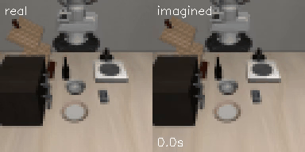
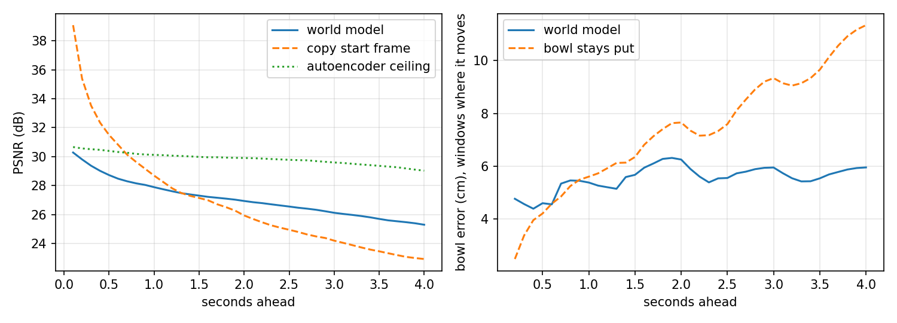
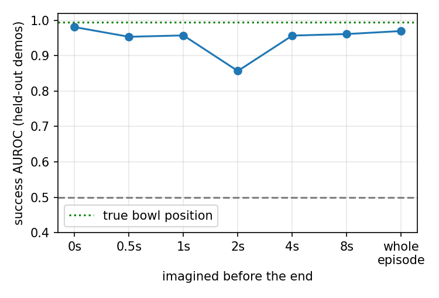

# phone2panda

**From iPhone videos of my own hand to a Panda robot in simulation.** I recorded myself putting a bowl on a
plate (iPhone with LiDAR, Stray Scanner app). The pipeline turns each recording into a metric 3D
demonstration, retargets it to a Franka Panda in LIBERO (task: LIBERO-Goal *"put the bowl on the plate"*),
and replays it in many fresh simulated scenes, so that the **simulator verifies every robot demonstration**.
On that data I train an ACT policy, add offline RL that learns from the failed rollouts, and train an
action-conditioned **world model** that predicts the camera view and whether a plan will succeed.

| Question | Result (95% Wilson intervals; LIBERO's 50 fixed evaluation scenes, never used for data) |
|---|---|
| Q1: How should a human demo be retargeted? | Intent-only 100%, object-relative 81%, absolute replay 0% (13 demos x 20 scenes each) |
| Q2: How good is a policy trained only on my phone demos? | ACT 57% [47-66] (438 sim-verified episodes from 10 demos) vs 97% [92-99] on 49 official teleop demos |
| Q2b: Does learning from failures help? | Not measurably. All 600 rollouts weighted by an IQL critic: 64% [54-73]; the same data unweighted: 60% [50-69]; successes only: 57% [47-66] (2 evals each, n=100). A first single evaluation suggested +12 points; re-evaluation showed it was mostly evaluation noise |
| Q3: Can a world model judge a plan before execution? | Success AUROC 0.93 imagining whole held-out episodes from their first frame (within one strategy); ranks the 3 strategies correctly |



*World model on a held-out demo: left the real camera, right the model's imagination from the first frame
and the action sequence alone (64 px, 10 Hz). Failure example: [assets/wm_hero_failure.mp4](assets/wm_hero_failure.mp4).*

## Pipeline

```
iPhone (RGB 1920x1440 + LiDAR + ARKit pose)             p2p/human/
  ArUco tags on table / bowl / plate -> metric table frame; ARKit + tag-anchored camera track
  MediaPipe hand -> pinch point, grasp point on the rim (camera ray ∩ rim plane), events: grasp/lift/place/release
        |
        v  13 demos that pass every check (data/splits.json): 10 for training, 3 held out
retargeting to the robot                                   p2p/retarget/
  absolute (hand path, one global offset) | object-relative (path anchored to bowl/plate) | intent (grasp side + place point)
        |
        v
sim-verified data generation (MimicGen-style)              p2p/data/
  60 fresh scenes per demo (objects shifted +-3 cm, grasp/place perturbed); LIBERO decides success
  600 rollouts -> 438 successes (ours_all), 50 balanced (ours_50); all 600 kept (ours_mix)
        |
        +--> ACT (LeRobot)                                 p2p/policy/   notebook 03
        +--> IQL critic -> advantage weights -> AW-ACT     p2p/rl/       notebooks 05, 03
        +--> world model (image + bowl, 10 Hz)             p2p/wm/       notebook 04
                 +--> world model as a plan critic                       notebook 07
```

## How to run

Everything that touches the simulator runs on Linux with a GPU (Colab T4 used throughout). Data and
checkpoints move between notebooks through a private Hugging Face dataset repo (`HF_TOKEN` in Colab secrets).

| Step | Where | Command / notebook | Time (T4) |
|---|---|---|---|
| Check a recording | Mac | `pip install -r requirements-mac.txt`; `python tools/check_recording.py <folder>` | seconds |
| Extract demos | Mac | `pip install mediapipe==0.10.14`; `python -m p2p.human.extract <raw_dir> data/processed` | minutes |
| Simulator sanity check | Colab | `notebooks/00_sim_sanity.ipynb` | ~10 min |
| Table 1 (retargeting) | any CPU | `python -m p2p.retarget.replay data/processed --inits 20` then `python tools/table1_summary.py` | ~40 min (2 cores) |
| Generate data | Colab | `notebooks/02_generate_data.ipynb` | ~65 min + ~30 min datasets |
| Train / evaluate ACT | Colab | `notebooks/03_train_eval_act.ipynb` (`DATASET` = official, ours_50, ours_all, ours_mix) | ~1.5 h per run |
| World model | Colab | `notebooks/04_world_model.ipynb` | ~1.5 h |
| Offline-RL weights | Colab CPU | `notebooks/05_offline_rl.ipynb` | ~25 min |
| Policy diagnostics (why ours < teleop) | Colab | `notebooks/06_policy_diagnostics.ipynb` | ~15-60 min |
| World model as a plan critic | Colab | `notebooks/07_wm_plan_selection.ipynb` | ~35-50 min |
| Tests (no simulator) | anywhere | `python -m pytest -q tests` | seconds |

Rendering must run on the GPU: Colab lacks the NVIDIA EGL vendor file, so MuJoCo silently renders on the
CPU (~2.6 steps/s instead of ~29). `p2p.sim.env.ensure_nvidia_egl()` fixes this and notebook 02 checks it.

## Data: my recordings

- 25 recordings. **13 pass every check** and are the main set (10 training, 3 held out, chosen before any
  training); 6 more with my *natural* grasp are used only in Table 1; 6 were excluded because the grasp
  point could not be measured (hand hidden at the grasp).
- Protocol (kept minimal): tags visible in the first second; grasp the bowl's left rim; hand and bowl visible
  from grasp to release; bowl on the plate visible at the end. The phone is hand-held: the camera track is
  ARKit, anchored to the table tag (camera spread 3-11 mm).
- Setup: an iPhone Pro (LiDAR) recording RGB, depth and ARKit poses with the Stray Scanner app; my own bowl
  (100 mm rim, 58 mm tall) and plate (198 mm); ArUco tags on the table (144 mm), bowl and plate, printed
  at 96% scale (`assets/phone2panda_tags_A4.pdf`; the scale is corrected in `p2p/config.py`). Real sizes
  are mapped onto LIBERO's smaller bowl and plate by scaling rim and plate radii.


*Left: my 13 demos as recorded. The bowl started in many places and the plate in a few, which is why a
replay in fixed coordinates (absolute) cannot work. Right: the same paths relative to the bowl, which is
how object-relative retargeting sees them. Straight segments are gaps where the hand tracker lost the hand.*

<!-- TODO(you): add one frame of a recording with the tag and hand overlay (the contact sheet that
tools/check_recording.py writes next to each recording, check_<name>.jpg, works well). -->

## Q1. Retargeting: what transfers from a human demo?

A recording gives my hand's 3D path (the point between thumb and index finger), the moments I closed and
opened my fingers, the point on the rim where I grasped, and where the bowl and plate were. Retargeting turns
this into a plan for the robot in its own scene: a sequence of gripper poses, each with the gripper open or
closed. Three ways to do it, from "copy everything" to "copy only the intent":

- **Absolute: replay my hand's path in fixed coordinates.** Every point of the path is mapped into the
  robot's frame by one transform shared by all demos: my seat becomes the robot's base, and my average bowl
  position becomes the simulator's average bowl position. Where the bowl and plate are in a particular robot
  scene is ignored. This is what treating the video as a robot trajectory means.
- **Object-relative: replay my path relative to the objects.** The approach and the grasp point are expressed
  relative to the bowl (heights relative to its rim), so they move with the bowl. The carry is stretched to
  start at the robot's bowl and end at the robot's plate while keeping its shape (how high and along which
  curve I carried it), and the bowl is set down at the same offset from the plate centre as in my demo.
- **Intent: keep only what I meant to do.** Two facts: which side of the bowl I grasped (an angle around the
  rim) and where on the plate I put it. The motion itself is a standard hand-written pick-and-place: above
  the rim, straight down, close, lift 12 cm, carry, lower, open.

In object-relative and intent, the wrist is turned so the two fingers close across the rim wall at the grasp
point. My own finger orientation is not used: it is noisy, and a slanted pinch lets the bowl twist.

Each of the 13 main demos replayed in 20 of LIBERO's evaluation scenes (`results/table1.md`):

| Strategy | Keeps from my demo | Success | Demos >= 50% |
|---|---|---|---|
| absolute | the whole hand path, in fixed coordinates | 0% [0-2] | 0/13 |
| object-relative | grasp point, approach, lift and carry shape, place point, all relative to bowl/plate | 81% [76-85] | 11/13 |
| intent | only the grasp side and the place point | 100% [99-100] | 13/13 |

Angles below go around the bowl in the robot's frame: 0° is the far side, 90° the robot's left, 180° the
side facing the robot, 270° the robot's right.

- **Absolute fails completely, as expected: it is the negative control.** My recordings were laid out
  differently each time. The bowl started a median 11 cm (2-37 cm) from its average position, and the plate
  lay in front of, beside or behind it, 26-39 cm away. In the robot's scenes the bowl is always near the same
  spot, 16 cm from the plate. A fixed replay therefore sends the gripper to where the bowl was in my
  recording, typically about 11 cm from where it is in the robot's scene, and the fingers close on empty air.
  The bowl ends a median 14 cm from the plate, having started 16 cm away: it is at most nudged, never carried.
- **Object-relative works for 11 of 13 demos; the other two inherit assumptions of my scene**
  (`results/table1_notes.md`):
  - `a4558` (1/20): I carried the bowl along an S-curve that swings about 9 cm to the robot's right and
    20 cm up. In my room that was free space; in the LIBERO scene a cabinet stands there. The held bowl hits
    the cabinet, the arm stalls for about 100 steps, and the bowl is released 11 cm above the table, 6-7 cm
    from the plate centre.
  - `c521` (4/20): I grasped at 149°, the most extreme side of all main demos (towards the side facing the
    robot). Following my approach path to that side, the arm gets stuck (about 230 of 300 steps) and the
    episode times out.

  Intent succeeds 20/20 on both, because it plans its own path. The more of the human motion we keep, the more
  of the human scene's assumptions we inherit.
- **My natural grasp side does not work for this robot.** In 6 extra recordings I grasped the bowl without
  instructions, on the side facing me or on my right. Mapped to the robot (my seat = the robot's base), that
  is the side facing the robot (177-200°) or the robot's right (272°). From there the retargeted grasps
  mostly fail: 9-20/20 at about 180°, 4-14/20 at about 200°, 0/20 at 272° (object-relative and intent). So
  the main recordings follow a protocol: grasp the bowl's left rim (86-149° in the robot's frame). This
  constraint on the human is a real limitation: a natural human grasp is not necessarily one the robot can
  execute.
- **Design choice: data generation uses object-relative, not intent**, although intent scores higher. Intent
  keeps only two numbers from the video, so its data would be my hand-written pick-and-place with two
  parameters set by the human, and a policy trained on it would learn the script rather than the
  demonstrations. Object-relative keeps the demonstrated motion, and the simulator discards the rollouts where
  that motion does not suit the robot's scene.

## Q2. Imitation from sim-verified phone data (ACT)

### How the robot demonstrations are made

There is no separate planner. The "teacher" that produces robot demonstrations is the retargeted plan,
executed by a simple feedback controller:

1. **Plan.** Object-relative retargeting (Q1) of one human demo onto a new scene gives about 30 gripper
   waypoints (position, wrist angle, open or closed).
2. **Execute.** Every 50 ms, a waypoint follower commands a move towards the current waypoint, proportional
   to the remaining distance, and moves on to the next waypoint once it is close enough (or after a timeout).
   The camera images and the commanded actions are recorded.
3. **Verify.** LIBERO's own success check decides whether the episode is kept.

To get many robot demos from 10 human ones (the MimicGen recipe), this runs in 60 fresh scenes per demo. The
bowl and plate are shifted by up to ±3 cm on top of LIBERO's own placement noise. The human's grasp point is
moved along the rim (standard deviation 1 cm, about 11° around the bowl) and the place point is moved
(1.5 cm), so the data covers more grasps than the 10 I recorded. Result: 600 rollouts, 438 successes (73%;
my per-demo prediction from physics-only replays was 75%). Failures are mostly near-misses: half end on the
plate but more than 3 cm from its centre, which LIBERO's `On` check rejects.

Datasets: `ours_all` = the 438 successes; `ours_50` = 50 successes (5 per demo), the same count as the
official demos; `ours_mix` = all 600 rollouts, successes and failures (for offline RL); `official` = the 49
teleoperated demos of this task in `lerobot/libero`.

### Results

ACT (LeRobot, 20k steps, batch 32, same settings for every run), evaluated on the 50 fixed scenes:

| Training data | Episodes | Success | Bowl never lifted | Lifted, off the plate | On the plate, > 3 cm off |
|---|---|---|---|---|---|
| official teleop (`lerobot/libero`) | 49 | **97%** [92-99] (2 evals, n=100) | 0 | 0 | 0 |
| ours_50 (count-matched) | 50 | **46%** [33-60] | 13 | 7 | 7 |
| ours_all | 438 | **57%** [47-66] (2 evals, n=100) | 16 | 4 | 1 |
| ours_mix + IQL advantage weights | 600 | **64%** [54-73] (2 evals, n=100) | 10 | 2 | 7 |
| ours_mix, unweighted (control) | 600 | **60%** [50-69] (2 evals, n=100) | 15 | 1 | 1 |

Failure columns are from one evaluation of 50 episodes each. For reference, the teacher itself (unperturbed plans of the 10 training demos, executed by the
follower) succeeds in 85% of these scenes (Table 1).

- **The gap to teleop is in grasping, not placing.** Most failures never lift the bowl. When our policy does
  grasp, it places about as accurately as the teleop policy (median 1.9 vs 1.1 cm from the plate centre).
- **9x more generated data: 46% -> 57%**, not significant. It seems to sharpen placement (7 vs 1
  off-centre failures) but not grasping.
- **No recovery behaviour:** after a missed grasp the policy hovers over the plate. The success-filtered data
  contains no recoveries.
- **How the policy executes its predictions matters for our data, not for teleop data** (same checkpoints,
  only the execution changed; `results/act/*/eval_n10.json`, `eval_te.json`):

  | Execution | official | ours_all |
  |---|---|---|
  | 25 of 50 predicted actions, then predict again (default) | 97% (n=100) | 57% (n=100) |
  | 10 of 50, then predict again | 96% | 50% |
  | predict every step, average all predictions for this step (temporal ensembling) | 100% | **12%** (33 of 44 failures never lift the bowl) |

  Looking more often does not help our policy, and averaging its predictions destroys it. See H2 and H5 below.

### Why is the policy trained on my demos worse than the one trained on teleoperation?

Both policies have the same architecture, settings, simulator, cameras and evaluation scenes; only the
demonstrations differ. What we know: most of our failures are missed grasps (16 of 21 never lift the bowl),
and successful grasps are followed by accurate placement. So the question is why grasps fail. Candidate
explanations and the evidence so far:

| | Hypothesis | Evidence so far | Test |
|---|---|---|---|
| H1 | **Teacher ceiling.** A student trained by imitation rarely beats its teacher. | Our teacher succeeds in 85% of these scenes; the official demos come from a human teleoperator, presumably near 100%. This explains at most ~15 of the 40 points: our student keeps 57/85 = 67% of its teacher's success, the teleop student 97%. | - |
| H2 | **Inconsistent grasps across demos.** In similar-looking scenes my 10 demos grasp different points of the rim (86-149°, so the wrist angle differs by up to 60°) and approach along 10 different paths. The image does not tell which demo to follow, so the policy may average them, and an average of two good rim grasps can be a grasp that matches neither. | **Supported.** Wrist angle at the moment of grasping, across episodes: teleop spread 5.6° (10th-90th percentile -12° to 1°), ours 21.3° (-8° to 51°), four times wider (`results/act/demo_consistency.jsonl`). Averaging the policy's own successive predictions (temporal ensembling) drops ours to 12%, mostly missed grasps, but leaves teleop at 100%: its predictions agree with each other, ours switch between grasps. Missed grasps dominate the failures; 9x more data of the same kind barely helps. | Training on a consistent subset of demos, or on intent data (one grasp style), would confirm it. |
| H3 | **The ±1 cm grasp perturbation** of data generation adds variety where the gripper closes. | Probably minor. Only perturbed rollouts that succeeded are kept, and the added spread (about 11° around the rim) is small next to the spread across my demos (about 20°): together about 23°. | Regenerate with `--grasp-sigma 0` and retrain. |
| H4 | **Too-clean demonstrations.** Scripted rollouts follow their plan almost perfectly, so the data never shows how to correct a small error. Teleoperators correct themselves all the time, which shows the policy how to recover. Once our policy is a few mm off, it is in states it has never seen. | After a missed grasp our policy hovers instead of trying again. | Add noise to the executed actions during generation while recording the follower's corrections (DART, Laskey et al., 2017). |
| H5 | **Open-loop chunks during a precise grasp.** ACT predicts 50 actions and executes 25 of them (1.25 s) before looking again, so an error in the chunk's grasp position is not corrected before the fingers close. Our policy also needs about twice as many steps (median 136 vs 74 to succeed), hence more chunks. | **Rejected.** Executing 10 instead of 25 actions per prediction gives 50% (vs 57%), re-predicting every step 12%. Committing to one chunk is what keeps our policy on one grasp; looking more often only gives it more chances to switch. | - |

Current reading: H1 explains part of the gap. H2 is now the best-supported cause of the rest: our
demonstrations grasp in four times more varied ways than teleop, and our policy behaves like one that has to
choose between several grasps for the same image (it works only when it commits to a chunk). H4 fits the same
pattern but is not tested yet; teleop demos also vary more where it helps (grasp height spread 1.2 cm vs our
0.13 cm), i.e. ours are varied where it hurts and rigid where variation would teach robustness. H3 is likely
minor; H5 is rejected. The next experiment that would settle H2: train on intent data or on demos with similar
grasp sides.

### Learning from failures (offline RL, gated)

ACT on successes only throws away the 162 failed rollouts. An IQL critic (expectile 0.7, gamma 0.99, reward 1
at success) trained on the simulator's 18-D state scores every frame: its advantage says whether the action
taken there did better or worse than usual from that state. ACT is then retrained on all 600 episodes with
loss weights `exp(beta * A)` on standardised advantages (beta = 1, mean 1, capped at 20). The critic sees the
simulator state, the policy only images.

- Gate, fixed before the run: the critic must tell success from failure halfway through an episode.
  AUROC 0.95 (0.66 from the first frame) -> passed (`results/rl/iql_diagnostics.json`).
- Weights: success frames 1.15 on average, failure frames 0.82; 36% effective sample size.
- Result, three ways to use the same 600 rollouts (each checkpoint evaluated twice on the 50 scenes):

  | Training data | First evaluation | Second evaluation | Pooled (n=100) |
  |---|---|---|---|
  | successes only (filtered imitation, ours_all) | 56% | 58% | 57% [47-66] |
  | all rollouts, unweighted (control) | 54% | 66% | 60% [50-69] |
  | all rollouts, IQL advantage-weighted | 66% | 62% | 64% [54-73] |

  The first evaluation suggested a 12-point gain from the weights. Re-evaluating the same checkpoints (GPU
  evaluation is not bit-reproducible) moved the unweighted run by 12 points, so a single 50-episode evaluation
  cannot resolve differences of this size. Pooled, the three are within noise of each other: **no measurable
  effect of learning from failures** at this scale (one training seed each).

## Q3. World model (Part B)

A world model predicts what the camera will see after a given sequence of robot actions, without running the
simulator. Here it is used to judge a plan before executing it.

```
 real camera frame (64x64 px)
        |  encoder (4 conv layers)
        v
   z_t: 256 numbers summarising the scene             robot actions for the next 0.1 s
        |                                             (2 control steps x 7 numbers = 14)
        v                                                         |
   +-----------------------------------------------+              |
   | GRU with a 512-number memory                  | <------------+
   | z_t+1 = z_t + predicted change                |
   +-----------------------------------------------+
        |   repeat from z_t+1 with the next actions: no new camera frames ("imagination")
        |
        +--> decoder (4 deconv layers) --> imagined camera frame at t+0.1 s
        +--> bowl head (small MLP)     --> bowl position (x, y, z) at t+0.1 s
```

- **10 Hz.** The robot is controlled at 20 Hz (one 7-number action every 50 ms: gripper move, wrist rotation,
  open/close). The world model takes steps of 0.1 s, so each of its steps consumes two consecutive actions (14
  numbers) and predicts the frame 0.1 s later. A 7 s episode is then 70 model steps instead of 140, which
  halves the number of predictions chained on top of each other.
- **Deterministic:** one predicted future per action sequence, no uncertainty.
- **Training signal:** real frames must survive encoder -> decoder; imagined frames must match the real future
  frames; imagined summaries are pulled towards the encoder's summary of the real future frame; and the bowl
  head must read the true bowl position (from the simulator) from both real and imagined summaries.
- **Open-loop training with a curriculum.** Each training example is a window of an episode: the model sees
  only its first real frame plus the actions, imagines the whole window step by step from its own
  predictions (as it will at test time), and is penalised at every step. Windows start at 8 steps (0.8 s) and
  grow steadily to 32 steps (3.2 s) by the middle of training (10k of 20k updates), then stay at 3.2 s. Short
  windows first teach one step of motion; long windows later teach the model not to drift, which matters
  because it is later asked to imagine whole episodes of up to 15 s.
- **Data:** 680 training episodes (+80 for validation) from the 10 training demos, successes and failures,
  all three strategies. Test: **180 episodes of the 3 held-out demos**, each replayed with all three strategies
  in the same 20 scenes.

### How well does it predict?

Starting from a real frame, the world model imagines up to 4 s ahead using the actions that were really
executed, and its prediction is compared with what happened (1226 start points: one per second of every test
episode, wherever 4 s remain). Two simple baselines and a ceiling put the numbers in context:

| Seconds imagined ahead | 0.1 | 1 | 2 | 4 |
|---|---|---|---|---|
| **Image similarity to the real frame** (PSNR, dB; higher is better) | | | | |
| world model: its imagined frame | 30.3 | 27.9 | 26.9 | 25.3 |
| baseline "nothing moves": the start frame itself | 39.1 | 28.7 | 25.9 | 22.9 |
| ceiling: the real frame passed through encoder and decoder | 30.7 | 30.1 | 29.9 | 29.0 |
| **Bowl position error while the bowl is moving** (cm; lower is better) | | | | |
| world model: bowl read from its imagined state | - | 5.4 | 6.3 | 6.0 |
| baseline "the bowl stays where it was" | - | 5.6 | 7.7 | 11.3 |

PSNR compares pixels: 30 dB is an average pixel error of about 3% of full brightness, 25 dB about 6%, 23 dB
about 7%. Bowl rows only count start points where the bowl has moved more than 2 cm by that time (none at
0.1 s), otherwise "stays where it was" would be trivially right. The same numbers, at every horizon:



- **Short horizons favour the "nothing moves" baseline.** In 0.1 s the scene hardly changes, so the start
  frame is almost a perfect prediction (39 dB). The model's frame is worse (30.3 dB) but only 0.4 dB below
  the ceiling: at short horizons its error is the blur of its autoencoder (every frame squeezed through 256
  numbers), not wrong motion.
- **From about 1.3 s on, the model beats "nothing moves"**, and the margin grows (25.3 vs 22.9 dB at 4 s): it
  predicts where the arm and the bowl go.
- **The gap to the ceiling grows from 0.4 to 3.7 dB over 4 s.** Each imagined step builds on the previous one,
  so small errors compound.
- **The bowl:** assuming it stays put is off by 11 cm after 4 s of carrying; the model by 6 cm, and its error
  does not grow with the distance travelled: it knows the bowl travels with the gripper. Its reading of a
  carried bowl is coarse, though (4-6 cm; at 64 px the bowl is small and partly hidden by the gripper),
  which is more than LIBERO's 3 cm success tolerance.

### Success from imagination

To judge an episode, take the real frame H seconds before its end, then imagine the remaining H seconds from
the recorded actions alone: every step in between is predicted from the model's own previous prediction, with
no further real frames. What is imagined is the model's internal summary, from which both a frame and the
bowl position can be read; for scoring, only the bowl position at the last step is used. The score is the
horizontal distance from that imagined bowl to the plate centre (the plate does not move). AUROC is the
probability that a random successful episode gets a smaller distance than a random failed one (0.5 = chance,
1 = perfect; the true final bowl position gives 0.99). H = 0 reads the bowl from the real last frame;
"whole episode" imagines everything from the first frame, which is the setting of judging a plan before
executing it.

| Imagined before the end | 0 | 0.5 s | 1 s | 2 s | 4 s | 8 s | whole episode |
|---|---|---|---|---|---|---|---|
| AUROC, all strategies (n=180) | 0.98 | 0.95 | 0.96 | 0.86 | 0.96 | 0.96 | 0.97 |
| AUROC, object-relative only (n=60) | 0.96 | 0.95 | 0.89 | 0.80 | 0.91 | 0.89 | **0.93** |



The object-relative row is the harder test: within one strategy, successes and failures look alike, whereas
across strategies "absolute never moves the bowl" is easy to see. The dip at 2 s is not understood. A
plausible cause: 2 s before the end the bowl is usually held in the gripper above the plate, partly hidden,
which is exactly where the bowl reading is least accurate; imagining from earlier frames starts from a clear
view of the bowl.

**Judging plans before execution** (from the first frame and the plan's actions). "Predicted" counts the
episodes whose imagined final bowl lies within 3.2 cm of the plate centre (a threshold chosen on the
validation episodes):

| Strategy | True success | Predicted by the world model |
|---|---|---|
| intent | 97% | 80% |
| object-relative | 57% | 32% |
| absolute | 0% | 0% |

It ranks the strategies in the true order, on demos it never saw, but is pessimistic: its coarse reading of
the bowl (see above) turns narrow successes into predicted failures.

**Why no "success" head.** An obvious design would add a classifier that reads "will this succeed?" from the
imagined state. In this data such a head can cheat: LIBERO ends an episode the moment it succeeds, while
failures run to the 300-step limit, so successes are short and failures long, and the end of a success
always shows the bowl just being set down. A head could learn to recognise the episode's length or its last
moments instead of the outcome; it would score well here and fail on plans of any other length. The bowl
position is supervised at every frame of every episode and is a physical quantity, so reading success from
it (with LIBERO's own criterion, distance to the plate centre) cannot take that shortcut.

## Takeaways: when do offline RL and the world model help?

**Offline RL (advantage-weighted ACT): no measurable benefit here.**
- Result: 64% with critic weights vs 60% on all rollouts unweighted and 57% on successes only (pooled over two
  evaluations each, intervals overlapping). An early single evaluation suggested +12 points; it did not survive
  re-evaluation.
- Why it could have helped: the failures are near-misses that look like successes until the last moment (half
  end on the plate, just over 3 cm off). Filtered imitation throws them away; plain imitation copies their
  mistakes. A critic that can tell them apart lets the policy learn from all 600 rollouts while leaning
  towards the actions that led to success.
- Why it did not: our main failure is choosing between inconsistent grasps (H2). The critic cannot fix that,
  because every grasp style in the data succeeds most of the time, so the weights have no reason to prefer one style;
  what they do down-weight is probably the near-miss end of failed episodes, which is not where our policy
  fails. More
  generally: (1) weighting only re-ranks actions that are in the data; it cannot create behaviour
  the data lacks, such as trying again after a missed grasp. (2) Early in an episode the critic cannot yet
  tell success from failure (AUROC 0.66 at the first frame), so the weights there are close to uniform and
  the approach to the grasp, where our policy fails most, probably gets little guidance. (3) It costs data:
  the effective sample size drops to 36%, which hurts more the smaller the dataset. (4) It needs a critic
  that is right; this one sees the simulator's state, which a real robot would not have.
- When it would help: when failures differ from successes in actions the policy can see and copy (here, a
  consistent grasp style but varied placement), and when evaluations are large enough to detect it.

**World model: helps as an evaluator of whole plans; not as a source of fine detail.**
- It works where success is decided by coarse facts visible at 64 px: did the bowl move with the gripper, and
  where did it end up. From the first frame and a plan's actions it separates successful from failed episodes
  (AUROC 0.93 within object-relative, 0.97 across strategies) and ranks the retargeting strategies correctly,
  on demos it never saw.
- It does not give calibrated probabilities (it is pessimistic, because its reading of a carried bowl is off
  by more than the 3 cm tolerance), it does not resolve millimetre contact events such as a rim pinch that
  slips, and at short horizons copying the current frame predicts pixels better.
- That is also why it was not used to train the policy: imagined rollouts with a 6 cm bowl error cannot teach
  a millimetre grasp. Screening plans is the use that matches its accuracy.
- Open: whether it improves a decision. Notebook 07 uses it to choose among 13 candidate plans in each
  evaluation scene. It can only help where candidates differ in outcome within a scene and its errors are
  smaller than those differences.

## What worked, what didn't

Worked
- The measurement chain: ARKit + tag-anchored camera track, LiDAR-free grasp point (ray-plane), sim-verified
  generation that reproduces my per-demo yield predictions within noise.
- Object-anchored retargeting (0% -> 81%), and the simulator as a filter.
- A small world model that ranks plans correctly on held-out demos.

Didn't (or only partly)
- Policies from phone data fall well short of teleop (57% vs 97%); grasp acquisition is the bottleneck,
  most likely because my demos grasp in four times more varied ways than teleop.
- Learning from failed rollouts (IQL weights): no measurable gain once evaluation noise was accounted for.
- My natural grasp side is unusable for this robot; the protocol had to constrain it.
- Faithful human paths can be wrong for the robot's scene (the cabinet collision).
- The hand tracker (MediaPipe) loses the hand exactly when it matters: at the grasp, the fingers are hidden
  behind the rim. 6 of 25 recordings had no measurable grasp point and were excluded; in the rest, the
  grasp point comes from the camera ray through the pinch pixel intersected with the rim plane, not from the
  hand's 3D landmarks.
- LiDAR and the tag's PnP pose disagree by 3-6% on the table tag's distance in every recording (the bowl tag
  agrees within 1%). I did not resolve it; I bypassed it, since every quantity the robot uses comes from the
  tags and the ray-plane grasp, not from LiDAR depth.
- Smaller recording-side fixes that each cost a debugging round: hand detection was poor on sideways phone
  frames (frames are now rotated upright first); autofocus changes the focal length by up to 3.4% within a
  recording (per-frame intrinsics from ARKit); the bowl tag is often hidden during the carry (the bowl track
  is filled in from the hand).

## Reproducibility notes

- Evaluation is not bit-reproducible on a GPU: re-evaluating the same checkpoint flipped 17 of 50 episodes
  (28 -> 29 successes), and another checkpoint moved from 54% to 66%. Headline rates pool two evaluations.
- Soft resets keep MuJoCo's solver warm-start: a seed fixes the scene exactly, not the rollout.
- One training seed per configuration; differences below ~15 points are not resolvable with n = 50.

## Related work

MimicGen (Mandlekar et al., 2023) for generating many robot demos from few; ACT (Zhao et al., 2023);
LIBERO (Liu et al., 2023); IQL (Kostrikov et al., 2021) and advantage-weighted regression (Peng et al., 2019);
DART (Laskey et al., 2017) for noise injection against covariate shift in imitation;
world models in the Dreamer line (Hafner et al.). Learning manipulation from human video: DexMV (Qin et al.,
2022), MimicPlay (Wang et al., 2023), EgoMimic (Kareer et al., 2024); Real2Render2Real (Yu et al., 2025) also
turns phone captures of a human demo into many robot demos.

## Layout

```
p2p/human/     phone recordings -> metric 3D in a table frame (Stray Scanner loader, ArUco tags, hands)
p2p/sim/       LIBERO wrapper (LeRobot-compatible observations), pose controller, scripted pick-and-place
p2p/retarget/  human trajectory -> robot waypoints (absolute / object-relative / intent)
p2p/data/      sim-verified data generation, LeRobot dataset I/O
p2p/policy/    ACT training and evaluation (with per-sample weights)
p2p/rl/        IQL critic -> advantage weights
p2p/wm/        action-conditioned world model: model, data, training, evaluation
notebooks/     Colab notebooks 00-07
tools/         tag sheet, recording checker, Table 1 summary, failure analysis (generated data and policies),
               yield estimate, demo consistency, nominal arm model fit
results/       every number in this README
tests/         python -m pytest -q tests
```
