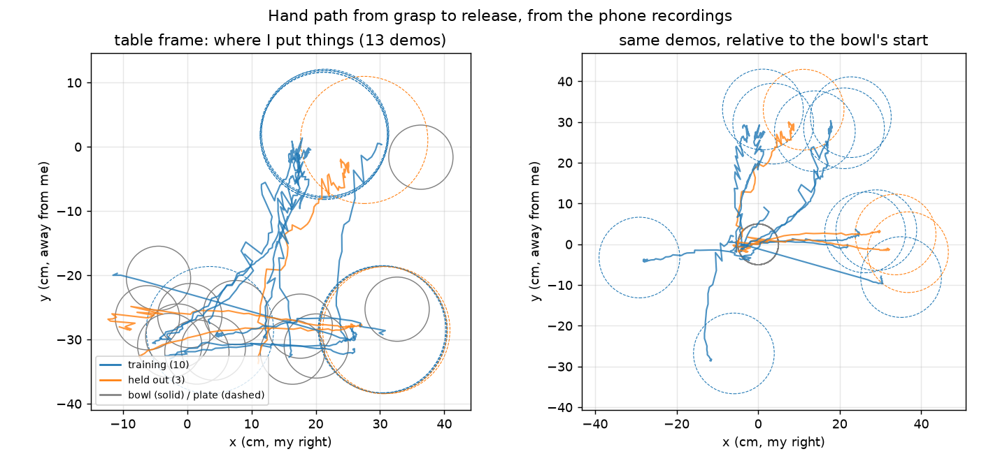
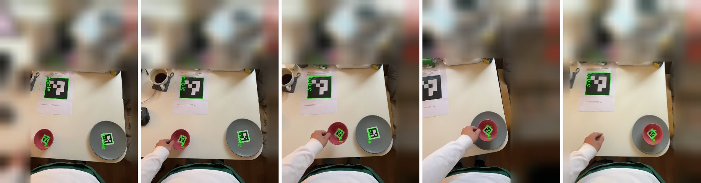

# Data: my recordings (full version)

- 25 recordings. **13 pass every check** and are the main set (10 training, 3 held out, chosen before any
  training); 6 more with my *natural* grasp are used only in Q1's retargeting test; 6 were excluded because the grasp
  point could not be measured (hand hidden at the grasp).
- Protocol (kept minimal): tags visible in the first second; grasp the bowl's left rim; hand and bowl visible
  from grasp to release; bowl on the plate visible at the end. The phone is hand-held: the camera track is
  ARKit, anchored to the table tag (camera spread 3-11 mm).
- Setup: an iPhone Pro (LiDAR) recording RGB, depth and ARKit poses with the Stray Scanner app; my own bowl
  (100 mm rim, 58 mm tall) and plate (198 mm); ArUco tags on the table (144 mm), bowl and plate, printed
  at 96% scale (`assets/phone2panda_tags_A4.pdf`; the scale is corrected in `p2p/config.py`). Real sizes
  are mapped onto LIBERO's smaller bowl and plate by scaling rim and plate radii.

*Left: my 13 demos as recorded. The bowl started in many places and the plate in a few, which is why a
replay in fixed coordinates (absolute) cannot work. Right: the same paths relative to the bowl, which is
how object-relative retargeting sees them. Straight segments are gaps where the hand tracker lost the hand.*

*Frames from one recording, from the contact sheet `tools/check_recording.py` writes (background blurred,
rotated so that my side of the table is at the bottom): the tags it found are boxed in green.*

## Checking and extracting a recording

- `python tools/check_recording.py <folder>` (Mac, seconds): checks that all three tags are seen in the first
  second, that the table tag anchors the phone's camera track, and that the bowl ends on the plate; writes a
  contact sheet (`check_<name>.jpg`) next to the recording, in which the hand should be visible from just
  before the grasp to after the release.
- `python -m p2p.human.extract <raw_dir> data/processed` (Mac, minutes): the metric 3D demo (hand path, grasp
  point, events, bowl and plate tracks) plus a QA plot per demo.
- The tag sheet to print: `assets/phone2panda_tags_A4.pdf`.

## Measurement lessons

- The hand tracker (MediaPipe) loses the hand exactly when it matters: at the grasp, the fingers are hidden
  behind the rim. 6 of 25 recordings had no measurable grasp point and were excluded; in the rest, the
  grasp point comes from the camera ray through the pinch pixel intersected with the rim plane, not from the
  hand's 3D landmarks.
- LiDAR and the tag's PnP pose disagree by 3-6% on the table tag's distance in every recording (the bowl tag
  agrees within 1%). I did not resolve it; I bypassed it, since every quantity the robot uses comes from the
  tags and the ray-plane grasp, not from LiDAR depth.
- Smaller recording-side fixes that each cost a debugging round: hand detection was poor on sideways phone
  frames (frames are now rotated upright first); autofocus changes the focal length by up to 3.4% within a
  recording (per-frame intrinsics from ARKit); the bowl tag is often hidden during the carry (the bowl track
  is filled in from the hand).
